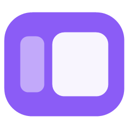

<p align="center"></p>

<h1 align="center">SpaceSwipe</h1>

<p align="center"><b>macOS-style three-finger swipes between full-screen apps, for Windows, with one row of apps per monitor.</b></p>

If you've moved from a Mac and you miss three-finger swiping between full-screen apps, this is for you.
SpaceSwipe gives every monitor its own row of full-screen apps. Drag three fingers on your trackpad and the
screen under your cursor slides to the next app. It follows your fingers, stops wherever you hold, and finishes or snaps back
when you let go. Your other monitors stay where they are.

- 🖐️ **Finger-tracked**: the slide follows your fingers. A flick or a drag past about 30% switches, anything less springs back.
- 🖥️ **Per monitor**: like macOS with *"Displays have separate Spaces"* turned on. Windows' own virtual desktops switch every monitor at once.
- 🪟 **Overview, like Mission Control**: swipe up with three fingers and the current app shrinks, following your fingers, into a row of live cards with every space on that monitor. Click one to zoom into it.
- ↔️ **Rearrange spaces**: drag cards in the overview to reorder them, or drag a card to a screen edge to send that app to another display.
- 🏠 **Desktop space**: the first space on each monitor is its desktop with your normal windows. Three-finger swipe down jumps straight to it.
- ⌨️ **Alt+Tab still works**, and so do the taskbar and Win+Tab.
- 🪶 **Small and self-contained**: one exe, no admin rights, no .NET install needed. It runs from the tray.

## Install

1. Download **[SpaceSwipe.exe](https://github.com/shaheershoaib/SpaceSwipe/releases/latest/download/SpaceSwipe.exe)**
   (or [SpaceSwipe-arm64.exe](https://github.com/shaheershoaib/SpaceSwipe/releases/latest/download/SpaceSwipe-arm64.exe) for Windows on ARM).
2. Run it. The setup window checks two things:
   - **A Precision Touchpad.** Most laptop trackpads already are one. For an **Apple Magic Trackpad**, install the free
     [Magic Trackpad driver](https://github.com/vitoplantamura/MagicTrackpad2ForWindows/releases) first. It supports
     USB-C and Lightning models, wired or over Bluetooth.
   - **Windows' own three-finger swipes are off.** Click *Open touchpad settings* and set
     *Three-finger gestures → Swipes* to **Nothing**, so Windows and SpaceSwipe don't both react.
   - **Optional: Windows virtual desktops.** SpaceSwipe gives each monitor its own spaces, so Windows' all-monitor
     desktops only get in the way, and apps on other desktops are hidden from SpaceSwipe. If you have several,
     *Merge into one desktop* moves every app onto one without closing anything. Setting *Four-finger gestures →
     Swipes* to **Nothing** stops you from switching desktops by accident.
3. Click **Install and start**. SpaceSwipe installs to `%LOCALAPPDATA%\Programs\SpaceSwipe`, adds a Start menu entry,
   and (optionally) starts when you sign in.

> Windows SmartScreen may warn about an unrecognised app the first time, because the exe isn't code-signed.
> Choose *More info → Run anyway*, or build it yourself from source (below).

## Use

| Gesture | What it does |
|---|---|
| Three-finger drag left / right | Slide to the next / previous full-screen app **on the monitor under the cursor** |
| Three-finger drag up | That monitor's overview: its spaces as live cards (follows your fingers; let go to open) |
| In the overview | Click a card, or `←` `→` + `Enter`, to switch. `Esc`, a click on the background, or a three-finger swipe down closes it |
| Drag a card in the overview | Reorder that monitor's spaces (`Ctrl` + `←` / `→` does the same). Drag it to the edge facing another display and let go to move the app there |
| Three-finger swipe down | That monitor's desktop space |
| `Ctrl` + `Alt` + `Win` + `←` / `→` / `↑` / `↓` | The same from the keyboard |


A *space* is any maximized or full-screen (F11, borderless) window. Spaces stay in a stable order and new ones are added at
the end. Minimized windows aren't spaces, the same as on macOS.

## Settings

Open **SpaceSwipe** from the Start menu while it's running, or double-click its tray icon. Changes apply immediately.

- **Monitors**: turn SpaceSwipe on or off per display. Displays are listed by name and position, and *Identify displays*
  shows their numbers. These settings follow the physical monitor even if Windows renumbers displays (e.g. after a KVM switch).
- **Gestures**: left/right switching, slide animation, reverse direction, swipe up (overview, Windows Task View or
  nothing), swipe down (desktop or nothing), and swipe distance.
- **Spaces**: whether borderless full-screen windows (games, F11 browsers) count, plus a list of apps that never count.
- **Keyboard**: the `Ctrl` + `Alt` + `Win` + arrow shortcuts.
- **About**: check for updates, the project page, setup checks and the log.

The tray menu also lets you pause SpaceSwipe or uninstall it.

## Update

Download the latest `SpaceSwipe.exe` and run it. It replaces the installed copy and restarts SpaceSwipe, keeping your settings.

## Uninstall

Settings → Apps → Installed apps → **SpaceSwipe** → Uninstall, or right-click the tray icon → *Uninstall SpaceSwipe…*.
Afterwards you can set *Touchpad → Three-finger gestures → Swipes* back to *Switch apps* to get Windows' default back.

## How it works

- **Gestures:** SpaceSwipe reads raw Precision Touchpad reports (HID digitizer usage page `0x0D`) in the background and
  tracks three-finger contacts itself, so it gets continuous finger positions rather than a one-shot "swipe" event.
- **The slide:** when a drag starts, a click-through overlay covers that monitor and shows the current and
  neighbouring apps as live window previews (DWM thumbnails) that follow your fingers. Nothing on screen changes
  during the drag, so it starts instantly. The real switch happens when you let go, behind a final frame that already
  shows the target. Previews go through the same colour pipeline as the real windows, so apps that render in HDR
  (Chromium/Electron apps on an HDR display) look identical. Screenshots don't: Windows squeezes HDR output into
  standard colour when it captures the screen.
- **The desktop space:** going to the desktop doesn't minimize your apps. It moves them just below the screen. A
  minimized window is shrunk by Windows and can take ~0.4 s to redraw when it comes back, which would show up as a
  wrong or half-drawn frame mid-swipe. Parked windows stay full size and fully drawn, so they slide back in instantly.
  A parked app comes straight back if you pick it with Alt+Tab, the taskbar or Task View. All parked apps come back
  if SpaceSwipe exits or crashes, or if your monitors change (e.g. a KVM switch).
- **The overview:** the whole animation is driven by one progress value tied to your fingers. Every app card is a
  live window preview. The current one shrinks into its slot while the background blurs, and the others fade in.
  When you pick one, SpaceSwipe switches to it behind the overview and grows its preview to full screen, so the
  hand-off to the real app is seamless. Only the desktop card is a picture, cached each time you visit it.

## Build from source

Requires the [.NET 9 SDK](https://dotnet.microsoft.com/download) on Windows 10 2004 or later.

```powershell
git clone https://github.com/shaheershoaib/SpaceSwipe
cd SpaceSwipe
dotnet publish -c Release -r win-x64 -o out   # -> out\SpaceSwipe.exe (single file, self-contained)
```

Diagnostics: `SpaceSwipe.exe --selftest` checks that the overlay reproduces the screen pixel-for-pixel on each monitor.
The log is at `%LOCALAPPDATA%\SpaceSwipe\log.txt`.

## Credits

- Apple Magic Trackpad support on Windows comes from [vitoplantamura/MagicTrackpad2ForWindows](https://github.com/vitoplantamura/MagicTrackpad2ForWindows),
  based on [imbushuo/mac-precision-touchpad](https://github.com/imbushuo/mac-precision-touchpad).
- Inspired by macOS Spaces. SpaceSwipe isn't affiliated with Apple or Microsoft.

## License

[MIT](LICENSE)
